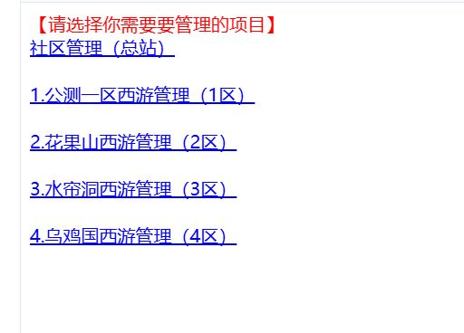
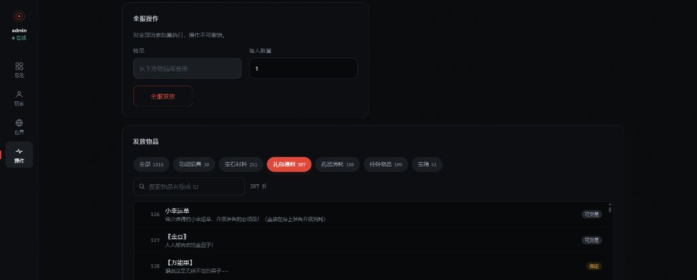

<div align="center">

# 幻想西游 · Docker 一键端

把只能在 Windows + phpStudy 下折腾的《幻想西游》网页游戏，做成 `docker compose up` 就能跑的服务

同时重写了 GM 管理后台

<sub>PHP 5.6 · MySQL 5.5 · Apache · Docker</sub>

</div>

---

## 这是什么

《幻想西游》是 2013 年停服的网页 MMO，源码流出来后一直有人在做复刻。原端是 Windows 时代的产物：

- 依赖 phpStudy 这种集成环境
- 要手动改 IP、改数据库配置
- 只能跑在 Windows 上
- GM 后台是 63 个散落的 PHP 文件

这个项目做了两件事：

1. **Docker 化** —— 一条命令部署，跨平台，配置全部自动化
2. **重写 GM 后台** —— 从「手填物品 ID」到「按分类点选」

---

## 快速开始

```bash
git clone https://github.com/Wenmoux/xiyou.git
cd xiyou/docker
cp .env.example .env
vi .env          # 改掉数据库密码和站点地址
./deploy.sh
```

部署完成后访问 `http://<你的IP>:8080/`

| 入口 | 地址 |
|---|---|
| 游戏首页 | `/` |
| 注册 | `/xxjy/regist.php` |
| 登录 | `/xxjy/login.php` |
| **GM 管理台** | `/gm/` |
| 原版 GM | `/admin/login.php` |

> GM 默认账号 `admin` / `123456`，**上线前务必修改**。

---

## GM 后台

原来的 GM 后台是 63 个散落的 PHP 文件，发物品要手填 ID。这次重写成单页控制台。

<table>
<tr>
<td width="50%"></td>
<td width="50%"></td>
</tr>
<tr>
<td align="center"><sub><b>原版</b></sub></td>
<td align="center"><sub><b>新版</b></sub></td>
</tr>
</table>

功能上原版的 17 项操作全部保留（查玩家、发物品、系统消息、官方动态、禁言封号、刷新缓存、全服发奖励等），
另加了批量操作、存档进度查看、活跃统计。充值、红包、兑换码三类依赖外部支付系统，本端未接入。

## 改造要点

原端能跑起来不容易，下面每条都是实测踩出来的。

### PHP 版本锁死 5.6

| 依赖 | 调用量 | 后果 |
|---|---|---|
| `mysql_*` 函数 | 1800+ 处 | PHP 7 已移除 |
| `each()` | 736 处 | PHP 7.2 移除 |
| `split()` | 47 处 | PHP 7 移除 |
| `<?` 短标签 | 1586 个文件 | 需 `short_open_tag=On` |

必须走 **Apache mod_php**（不是 php-fpm）——旧代码大量用相对路径 `include`，依赖「CWD = 入口脚本目录」这个语义。

### bcmath 是硬需求

`fqxy/wp/funk1.php` 的 `calc()` 用 `bcadd/bcsub/bcmul/bcdiv` 处理大额银两。游戏里 1 金锭 = 99 亿银两，超过 PHP 整数范围。缺了它进游戏直接 Fatal error。

### MySQL 默认字符集要改成 utf8

原端 `my.ini` 写的是 `character-set-server=gbk`，但：

- 数据实际以 UTF-8 存储（`hex` 验证：`测试` = `E6B58BE8AF95`）
- 表定义是 `DEFAULT CHARSET=utf8`
- 页面声明 `charset=utf-8`

而全局连接**不执行** `set names`（只有部分脚本里显式调用了 418 次）。服务端默认值必须是 utf8。

### 玩家存档目录要打通

原端有两套 `.ini` 缓存：

| 层 | 代码 | 实际目录 | 内容 |
|---|---|---|---|
| 登录层 | `xxjy/*.php` → `../ache/<id>` | `WWW/ache` | 登录令牌，每号 1 个文件 |
| 游戏层 | `fqxy/*.php` → `ache/<id>` | `WWW/fqxy/ache` | 完整存档，最多 65 个文件 |

两层互相看不见。镜像里把 `WWW/ache` 做成软链接指向游戏层目录。

### 补全「登录成功 → 进入游戏」

原端登录后只显示「登录成功」，**没有任何通往游戏的链接**。而且两层的 `user.ini` 格式不兼容：

```ini
# 登录层写的
[35博客家园玩家信息]
[验证信息]
玩家id = 10000008
玩家验证 = <md5>
玩家昵称 = admin

# 游戏层要求的
[10000008]                  ← 段头必须是玩家 ID
[验证信息]
玩家游戏码 = <30位随机码>    ← 缺失则报 #2 验证失效
cmid值 / xcmid值 / dcmid值  ← 缺失则页面渲染半截就停
[地图坐标] / [最后页面id] / [超链接值]
```

游戏入口校验 `sid == 玩家游戏码`（`xy.php:249`），登录层从不生成这个字段。补了 `play.php` 做格式转换。

### 新玩家要预建 28 种分表

每个玩家在 `xyy` 库有一套独立分表（`wp<id>` 背包、`zb<id>` 装备、`hd<id>` 活动…）。

部分 `*_ini.php` 会 `SHOW TABLES` 再建表，但 `hd_ini.php` 等**直接 `select`**。新号进去就报：

```
Error: Table 'xyy.hd10000010' doesn't exist
```

`play.php` 用老玩家表结构作模板一次性补全。

### 移除跨站验证

`fqxy/xyy.php` 会 curl 到「家园总站」验证玩家。独立部署时 `host` 指向自己，变成**自己请求自己** —— Apache worker 等自己返回，挂到超时，前端 502。

改成单机模式本地校验，需要多区互联时放一个 `config/remote_auth.flag` 就能恢复原逻辑。

### 静态资源笔误

原端引用了一堆不存在的文件：

| 引用 | 实际 |
|---|---|
| `ch5game.css` | `h5game.css` |
| `ccolorbutton.css` | `colorbutton.css` |
| `favicon.png` | `favicon.ico` |
| `inital-scale` | `initial-scale` |
| `content="...no;"` | 分号应为逗号 |

共 21 个文件、111 处。直接改了源码——这跟部署环境无关，改一次永久生效。

---

## 目录结构

```
xiyou/
├── docker/                     部署配置（不含业务逻辑）
│   ├── deploy.sh               一键部署 + 健康检查
│   ├── docker-compose.yml      MySQL 5.5.62 + PHP 5.6 Apache
│   ├── .env.example            配置样例
│   ├── php/Dockerfile          PHP 5.6 + mysql/mysqli/bcmath
│   ├── php/entrypoint.sh       注入 DB/站点地址，等库就绪
│   ├── apache/hxxy.conf        虚拟主机
│   └── mysql-init/01-schema.sql 225 张表结构
│
├── phpstudy/WWW/               游戏源码
│   ├── play.php                进入游戏入口（新增）
│   ├── class/user_ini_compat.php  存档兼容 + 建表（新增）
│   ├── gm/                     GM 管理台（全新）
│   │   ├── index.php
│   │   ├── api.php             31 个接口
│   │   ├── lib/{db,auth}.php
│   │   ├── data/items.min.json 1016 件物品索引
│   │   └── assets/{gm.css, gm.js}
│   └── ...                     原有游戏代码
│
└── docs/screenshots/           对比截图
```

---

## 运维

```bash
cd docker
./deploy.sh status     # 状态
./deploy.sh logs       # 日志
./deploy.sh down       # 停止
./deploy.sh reset      # 清空所有数据（危险）
```

备份玩家存档：

```bash
docker run --rm -v xiyou_web-data:/d -v $(pwd):/b alpine \
  tar czf /b/players-$(date +%F).tar.gz -C /d .
```

备份数据库：

```bash
docker compose exec -T mysql mysqldump -uroot -p"$MYSQL_ROOT_PASSWORD" \
  --databases xyy xxjyuser wuzhi_data > backup-$(date +%F).sql
```

---

## 已知限制

- **不要直接暴露公网** — 原端有大量 SQL 拼接、GM 弱口令、任意文件读写。建议加反向代理和访问控制
- **23:50 后拒绝登录** — `fqxy/aqbf.php` 的日结逻辑，原端设计
- **100ms 内重复请求提示「刷新过快」** — 防刷机制，正常游玩不受影响
- **`cmd` 不能跳号** — 游戏靠服务端生成的按钮序列推进
- **充值 / 红包 / 兑换码未接入** — 依赖原端支付网关

---

## 技术备注

- `php:5.6.40-apache` 基于 Debian 9（已 EOL），Dockerfile 把 apt 源指向 `archive.debian.org`
- 不装 GD：全站 `imagecreate/imagepng/imagettftext` 调用数均为 0
- `mysql:5.5.62` 与原端 5.5.47 同代，避免 MyISAM + 零日期兼容问题
- MySQL 关闭 STRICT 模式：原数据里有 `0000-00-00 00:00:00`
- 数据库初始化只保留表结构，玩家数据已清空

---

## 源码来源

游戏源码来自网络流传的**《幻想西游》一键端整合包**（phpStudy 打包的 Windows 版本），
本仓库在此基础上完成 Docker 化改造与 GM 后台重写，**未使用其他复刻项目的代码**。

版本谱系：疑似衍生自《小轩西游》→《再梦西游》一脉，但来源已不可考，
本仓库不对其谱系做断言。

> 期间曾参考 [wap-game/xiyou](https://github.com/wap-game/xiyou)
> 做代码对比（确认了两版逻辑一致，差异仅格式化与站名），
> 但**未采用其任何代码**，仅作事实核对。

## 声明

本项目仅供学习研究。游戏素材版权归原权利人所有，请勿用于商业用途。
